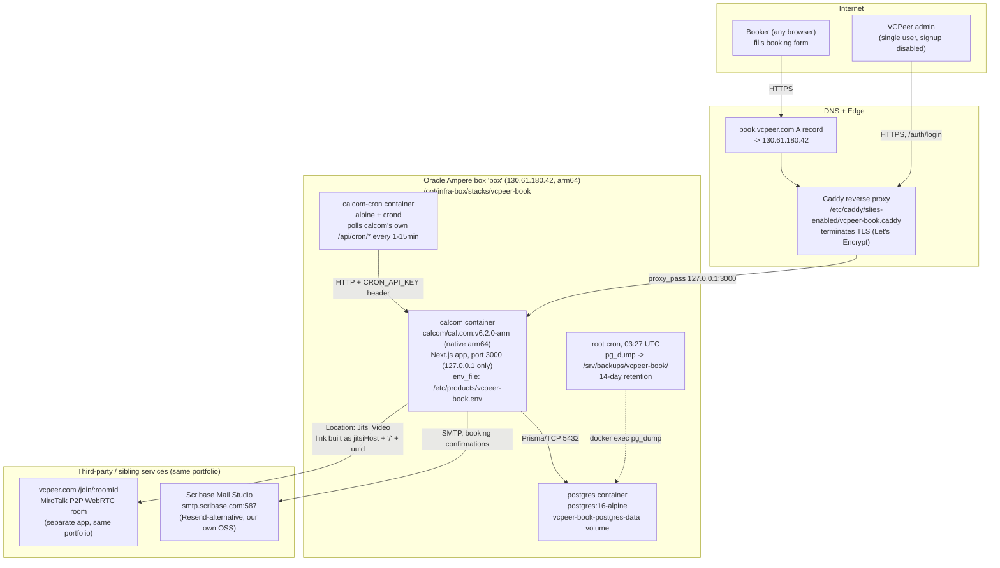

# VCPeer Book — Architecture (2026-10-23)

Scope: technical architecture, data flows, risks, next-build priorities.
Competitive positioning and growth moves live in `STRATEGY-2026-10-23.md`.
No `PLAN-2026-10-23-DEEP.md` exists in this repo as of this writing — not
duplicating anything, this is a standalone technical read of the real repo.

## 0. What this actually is

Not a custom app. It is **Cal.com community edition** (upstream repo
renamed `calcom/cal.diy`, MIT), run as an unmodified Docker image with
branding applied entirely through env vars + a container-start string patch
+ direct SQL seed rows — zero forked source. Confirmed by reading
`docker-compose.yml`, `.env.example`, `deploy/RUNBOOK.md`,
`deploy/apply-vcpeer-branding.sql`, `branding/README.md`, `NOTES.md`.

- **Hosting target:** Oracle Ampere ARM64 box `box` (`130.61.180.42`) — one
  of the shared free Oracle boxes this portfolio standardizes on. Not
  Cloudflare Workers/Pages; not `railyard-box` or `recoder-micro`. Confirmed
  by `deploy/RUNBOOK.md`'s "Current live status" line and stack path
  `/opt/infra-box/stacks/vcpeer-book/`.
- **Live today:** `https://book.vcpeer.com` — verified in RUNBOOK.md via
  real HTTP checks (`/auth/login`, `/admin/30min`, valid LE cert through
  2027-01-12).
- **Git remote:** `github.com/caelum0x/vcpeer-book` (fork), 5 commits so far,
  all docs/env/branding fixes — no application code has been written for
  this product, by design (it is a themed deployment, not a greenfield app).

## 1. System diagram (real components only)

Notes on what is deliberately **not** in the diagram because it does not
exist in the real deployment: no queue/broker (cron polling substitutes for
one), no Redis/cache layer, no CDN in front of the app, no Google/Office365
calendar credentials connected (installed but `enabled=false`, zero OAuth
keys — confirmed in `NOTES.md`), no mailpit in production (dev-only,
profile-gated out of the default `docker-compose up -d`).

## 2. Data flow — 3 key user actions

### 2.1 Booker books a slot (the core conversion event)

1. Booker's browser -> `https://book.vcpeer.com/<org-slug>/<event-type>`
   via DNS -> Caddy (TLS termination) -> `127.0.0.1:3000` -> `calcom`
   container.
2. `calcom` queries Postgres for the event type's `Schedule`/availability
   rows and existing `Booking` rows for that user to compute free slots.
   **No external calendar is queried** — zero `Credential` rows for
   google-calendar/office365-calendar exist today (NOTES.md), so "free" only
   means "not already booked inside Cal.com's own DB," not "free on the
   admin's real calendar."
3. Booker submits the form -> `calcom` writes a `Booking` row to Postgres,
   and (per the Jitsi app config seeded by
   `deploy/apply-vcpeer-branding.sql`) generates a location URL
   `https://vcpeer.com/join/<uuid>` using the stock, unmodified
   `packages/app-store/jitsivideo` adapter — it mints a UUID per booking
   and concatenates it onto the configured `jitsiHost`. This is **not**
   real Jitsi infrastructure; it is Cal.com's Jitsi app being repurposed to
   generate a link into VCPeer's own MiroTalk-P2P-based room server
   (`vcpeer/app/src/server.js`'s `/join/:roomId` route), a completely
   separate codebase/process on a different domain.
4. `calcom` sends the confirmation email via SMTP to `smtp.scribase.com`
   (Scribase Mail Studio, in-portfolio). Email body contains the booking
   time + the `vcpeer.com/join/<uuid>` link.
5. At meeting time, both parties independently load `vcpeer.com/join/<uuid>`
   — a second, unrelated system boots a WebRTC room (STUN/TURN per
   `vcpeer/app/src/server.js`). `book.vcpeer.com` has no further role once
   the link is handed out.

### 2.2 Reminder / webhook delivery (background, not request-driven)

1. `calcom-cron` container's crond fires on a fixed schedule (every minute
   for `webhookTriggers`, every 15 min for `bookingReminder` and
   `scheduleEmailReminders`, hourly for `changeTimeZone`).
2. Each fire is a plain `curl -X POST` to `http://calcom:3000/api/cron/<job>`
   over the internal `vcpeer-book` Docker network, authenticated with the
   `authorization: $CRON_API_KEY` header — not a queue, not a webhook
   subscription system, just Cal.com's own hosted-cron endpoints being
   polled locally instead of by upstream's GitHub Actions.
3. `calcom` reads/writes `Booking`/`Workflow`/`Webhook` rows in Postgres
   inside the request, then (for reminders) calls out to
   `smtp.scribase.com` again.
4. Before `calcom-cron` existed (shipped 2026-10-21), `CRON_API_KEY` sat
   generated and unused in `.env` — these jobs **never ran** in production.
   This is a shipped fix, not a hypothetical risk.

### 2.3 Nightly backup (operational, not user-facing)

1. Root cron on the box (`/etc/cron.d/vcpeer-book-backup`, 03:27 UTC) runs
   `docker exec vcpeer-book-postgres pg_dump -U calcom -Fc calcom` and
   writes the dump to `/srv/backups/vcpeer-book/`, `root:root 0700`.
2. `find ... -mtime +14 -delete` on the same line enforces 14-day retention.
3. This is the **only** copy of booking/user data outside the single
   Postgres container's Docker volume — there is no replica, no off-box
   copy, no managed Postgres (not Neon/Supabase for this product, unlike
   most of the rest of the portfolio).

## 3. Real architectural risks / bottlenecks (zero-budget constraint)

- ~~Single box, single Postgres container, no off-box replica~~ —
  **corrected 2026-10-23, this was wrong.** The nightly `pg_dump` under
  `/srv/backups/vcpeer-book/` IS covered by the box-wide
  `/opt/infra-box/backup/backup.sh` restic-to-Cloudflare-R2 job
  (`backup.timer`, 03:30 UTC) — `/srv` is one of its backed-up paths and
  `/srv/backups/vcpeer-book` is not in `excludes.txt`. Confirmed live:
  `restic ls latest /srv/backups/vcpeer-book` on `box` lists all three
  retained daily dumps inside the latest snapshot. A box-level disk failure
  does not take the backups with it. See `NOTES.md`'s 2026-10-23
  correction for the full verification.
- **No real calendar-conflict checking.** Zero Google/Office365 calendar
  credentials are connected (confirmed in Postgres: only a `jitsi_video`
  row in `Credential`, zero `Schedule` rows beyond Cal.com's hardcoded
  default). Every slot shown as "free" is only free relative to
  VCPeer-Book-originated bookings. A booker can double-book the admin
  against a real external meeting with zero warning — directly contradicts
  the strategy doc's stated ICP risk ("developers will churn immediately if
  double-booked").
- **Signup is hard-disabled (`NEXT_PUBLIC_DISABLE_SIGNUP=true`).** This is
  correct for "internal scheduling tool" but is the literal blocker the
  strategy doc identifies for turning booker goodwill into a second
  self-serve user — today there is no code path at all for a second org/user
  to sign up, not even a broken one.
- **Email deliverability is unverified in one direction.** SPF is confirmed
  live (`dig TXT vcpeer.com` -> `include:eu.rp.oracleemaildelivery.com`),
  but DKIM signing for `bookings@vcpeer.com` is explicitly flagged
  unconfirmed in `NOTES.md` — reminder/confirmation emails may be
  landing in spam for some recipients with no current way to detect it from
  the box alone (needs the OCI Email console, owner-only).
- **Image pin is stuck one release behind upstream's rename, by necessity,
  not choice.** `calcom/cal.diy`'s Docker Hub namespace exists but has
  zero published tags (`tags/?page_size=5` -> `count: 0`, re-verified
  2026-10-21). The app is pinned to `calcom/cal.com:v6.2.0-arm`
  indefinitely until upstream actually ships a `cal.diy` image — a
  dependency entirely outside this product's control, with no local
  mitigation beyond re-checking before every redeploy.
- ~~One brand-color field is live-drifted~~ — **fixed 2026-10-23**, see
  `branding/README.md` and `NOTES.md`. Ran `deploy/apply-vcpeer-branding.sql`
  against the live container; verified `#4678F9` now renders on
  `https://book.vcpeer.com/admin/30min`.
- **No app-level monitoring/alerting.** Health relies on Docker
  `healthcheck:` blocks (container restarts) and manual `curl`/`docker logs`
  checks during a pass — there is no automated notification if `calcom`,
  `postgres`, or the cron sidecar silently goes unhealthy between passes.

## 4. Prioritized next-build list (effort vs. impact)

1. **Connect Google Calendar OAuth for the admin account.** Highest impact
   on trust for the exact ICP (developers who will churn on a double-book)
   per the strategy doc; blocked only by one owner-only step (GCP OAuth
   client creation + one interactive consent login), the code path
   (`google-calendar` app) is already installed and just disabled. Low
   engineering effort once the OAuth client exists — this repo's part is
   setting two env vars and flipping an in-app toggle.
2. ~~Off-box backup copy~~ — **done already, not a real gap (corrected
   2026-10-23).** See section 3's correction: the box-wide restic job
   already covers `/srv/backups/vcpeer-book`.
3. **Turn on self-serve signup behind a real free-tier gate**, per the
   strategy doc's stated precondition for a second user. This is the
   largest-effort item here (needs plan+build of a plan-gating layer —
   Cal.com itself has no built-in paid-plan gate out of the box — likely via
   the org/teams model or a thin proxy check) but it is also the only item
   on this list that unlocks a genuinely new growth channel rather than
   derisking the existing one.
4. **DKIM verification for `bookings@vcpeer.com`.** Low engineering effort
   (one OCI console check), currently blocked on console access rather than
   code; worth doing before any public push since a failed DKIM check
   silently drops deliverability with zero in-app symptom.
5. ~~Fix the live brand-color drift~~ — **done 2026-10-23**, see
   `branding/README.md`.
